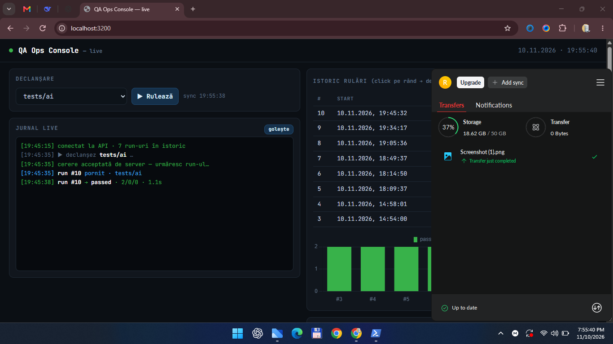

# QA Automation Framework



Framework de testare automată în **buclă închisă pe trei straturi**: UI (Playwright), API (captură trafic cu `postman-playwright` + validare `pm.test` prin Postman CLI) și bază de date (MySQL, aserțiuni de persistență într-o conexiune separată de cea a aplicației).

Clonat → `npm install` → `npm test`. Atât. Aplicația demo și MySQL-ul ephemeral sunt pornite automat de `globalSetup`.

## Arhitectură

```
tests/          scenarii de business — fără selectori, fără SQL, fără detalii API
pages/          Page Object Model — selectorii și acțiunile sunt încapsulate aici
fixtures/       injecție de dependențe: page objects + client DB injectate automat
api/            abstracție pentru apeluri API independente (fără browser)
test-data/      date de test separate de cod (JSON)
utils/          generare de date unice, logging, conexiune MySQL
test-app/       aplicația demo testată: Node http + MySQL, zero dependențe noi
```

**Regula de fier:** UI-ul se schimbă → se modifică doar `pages/`. Datele se schimbă → doar `test-data/`. Schema DB se schimbă → doar `fixtures/db.schema.ts`. Fișierele din `tests/` nu necesită modificări în aceste situații.

**Stratul API.** Capturarea traficului e activată la nivel de config prin `withPostman(defineConfig(...))` — acoperă toate paginile și contextele, inclusiv cele create manual, fără nicio schimbare în codul de test. Validarea `pm.test` se declanșează rulând:

```
npm run test:api
```

care execută `postman application test -- npx playwright test`. Necesită `POSTMAN_API_KEY` și o colecție sincronizată în workspace-ul Postman (numele coleсției e în `postman.config.cjs`). Rezultatele apar în `pm-results/`: ce teste UI au trecut, ce apeluri au fost capturate, care au fost mapate la colecție și validate cu `pm.test`, și care nu au fost mapate (goluri de acoperire API).

**Stratul DB.** Fiecare test primește fixture-ul `db` (o conexiune MySQL în tranzacție proprie, nivel de izolare `READ COMMITTED`):

- `expect(db).toHaveRecord('orders', { shipping_phone: phone })` — rândul există
- `expect(db).toHaveNoRecord(...)` / `expect(db).toHaveRecordCount(...)`
- `db.query(...)`, `db.findOne(...)`, `db.count(...)` — query-uri parametrizate (`??` pentru identificatori, `?` pentru valori; zero interpolare de stringuri)

**Izolarea** — trei mecanisme combinate, necesare pentru că aplicația comită pe propria conexiune, imposibil de rollback-uit din test:

1. Tranzacție per test + `ROLLBACK` automat — orice rând scris direct de test dispare
2. Cheie unică per rulare (`randomPhone()` din `utils/data-generator.ts`) — rândurile scrise de aplicație sunt întotdeauna ale testului, nu ale altor rulări
3. `db.cleanupLater('orders', { ... })` — rândurile scrise de aplicație sunt șterse explicit după rollback

Rezultat: două rulări consecutive produc aceleași rezultate, fără interferențe.

**Important (istoric de proiect):** pachetul `@ochorocho/playwright-db-connector` din specificația inițială nu există pe npm. Stratul DB e implementat local în `fixtures/db.client.ts` + `utils/db.ts`, cu interfața cerută (`expect(db).toHaveRecord`), fără dependențe externe.

## Selector strategy

Prioritate: **Test ID > ARIA > name > clasă semantică > CSS generic > text > XPath**. Page Object-urile folosesc exclusiv `getByRole` / `getByLabel` / `getByTestId` — zero `page.locator('div > span')`. Aplicația demo a fost construită cu ARIA complet (`role="alert"`, `role="status"`, `aria-label`, `<label for>`) ca selectorii să fie naturali, nu ad-hoc.

## Rulare în 10 minute (nou membru)

```bash
git clone https://github.com/thekyng1/qa-automation-framework.git
cd qa-automation-framework
npm install                      # include mysql-memory-server + mysql2
npm test                         # teste UI + DB (closed-loop complet)
npm run test:api                 # adaugă validarea pm.test (necesită POSTMAN_API_KEY)
npx playwright show-report       # raport HTML interactiv
```

Cerințe: Node 20+, Playwright browsers (`npx playwright install --with-deps chromium` la prima instalare pe Linux). Nu e nevoie de MySQL instalat local — `mysql-memory-server` pornește un mysqld 8.4 ephemeral înainte de teste și îl oprește după.

## Structura și detaliile de implementare

```
project-root/
├── playwright.config.ts          # withPostman + globalSetup/Teardown + trace/artefactе
├── postman.config.cjs             # colecția țintă + filtre de zgomot
├── fixtures/
│   ├── db.fixture.ts              # globalSetup: MySQL ephemeral + schema + seed + lansează test-app
│   ├── db.teardown.ts             # oprește test-app + MySQL
│   ├── db.schema.ts               # DDL + seed (users, products, orders)
│   ├── db.client.ts               # client per test: tranzacție, rollback, cleanupLater, toHaveRecord
│   ├── db-helper.ts               # DEPRECATED — stub fail-fast către fixture-ul db
│   └── pages.fixture.ts          # sursa unică de adevăr: test, expect, PageObjects, db
├── pages/
│   ├── login.page.ts / inventory.page.ts / checkout.page.ts
├── api/
│   └── orders.api.ts              # strat API independent
├── test-data/
│   ├── users.json / products.json
├── utils/
│   ├── db.ts                     # conexiune partajată, query parametrizat, findOne/count
│   ├── data-generator.ts          # randomPhone, randomEmail
│   └── logger.ts                  # step logger
├── test-app/
│   ├── server.js                 # API demo: /health, /api/auth/login, /api/products, /api/orders
│   └── public/index.html         # SPA accesibilă: login, shop, checkout
├── tests/
│   ├── login.spec.ts              # 2 teste auth
│   ├── inventory.spec.ts          # 2 teste shop UI
│   ├── orders-api.spec.ts         # 2 teste API + DB
│   └── e2e/checkout.spec.ts       # closed-loop: UI → API capture → DB
└── .github/workflows/ci.yml      # push/PR → npm ci → playwright test, artefacte if: always()
```

## Depanare

Ordinea obligatorie: **1) trace** (`npx playwright show-trace trace.zip` din `test-results/`), **2) pm-results/** pentru contractul API, **3) starea bazei** (conectează-te la portul din log-ul `[test-app]`, verifică `orders`). Regulă de fier: nu modifica aserțiunile ca testele să treacă — dacă testul pică, aplicația sau fixture-ul are o problemă reală.

## Artefacte și trasabilitate

| Artefact | Config | Scop |
|---|---|---|
| Trace | `trace: 'on-first-retry'` | DOM + rețea + consolă, `npx playwright show-trace` |
| Screenshot | `screenshot: 'only-on-failure'` | captură la eșec |
| Video | `video: 'retain-on-failure'` | înregistrare la eșec |
| Raport API | `pm-results/` | rezultate pm.test (postman-cli) |
| Raport HTML | `playwright-report/` | raport interactiv Playwright |
| JSON | `playwright-report.json` | citit de postman-cli pentru captura API |

Toate artefactele se încarcă în CI cu `if: always()` — indiferent de rezultat.

## CI/CD

`.github/workflows/ci.yml`: push/PR pe `main` → `npm ci` → `npx playwright install --with-deps chromium` → `npx playwright test`. MySQL ephemeral e gestionat de globalSetup, deci pipeline-ul nu are nevoie de serviciu MySQL extern; artefactele (`playwright-report/`, `test-results/`, `pm-results/`) se încarcă mereu, cu `if: always()`.

## Strategie de întreținere

| Schimbare | Ce modifici | Ce NU se atinge |
|---|---|---|
| UI redenumit/rearanjat | `pages/` | `tests/`, `fixtures/` |
| Date de test | `test-data/` | codul |
| Contract API (endpoint nou, payload nou) | colecția Postman + `api/` | `tests/` |
| Schema DB | `fixtures/db.schema.ts` | restul |
| Aplicație reală (nu demo) | `BASE_URL` + seed-ul + colecția | arhitectura framework-ului |

**Extindere:** adaugi Page Object → îl exposezi în `pages.fixture.ts` → testul nou primește instanța prin destructuring. Adaugi fixture nou → compun în `pages.fixture.ts`. Adaugi test closed-loop → copiază șablonul din `tests/e2e/checkout.spec.ts` (cheie unică + toHaveRecord + cleanupLater).

## Limitări oneste (documentate, nu ascunse)

- **mysql-memory-server** descarcă binarele mysqld la prima rulare pe o mașină nouă (cache local apoi). În CI, cache-ul de actions poate accelera acest pas.
- **postman-playwright** necesită o colecție Postman sincronizată în workspace (nu versionată în repo) + `POSTMAN_API_KEY`. Fără ele, `npm test` rămâne complet funcțional; doar validarea `pm.test` lipsește.
- **Token-urile demo** sunt base64 pseudo-token-uri, nu JWT — suficient pentru contractele UI→API→DB testate.
- **db-helper.ts** e păstrat doar ca stub deprecat fail-fast, ca vechile importuri să picte loud, nu silent.
